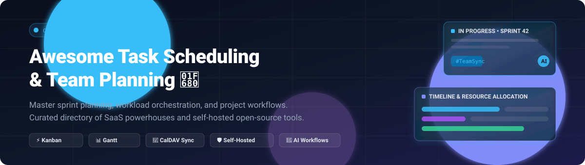

# 🚀 Awesome Task Scheduling &amp; Team Planning 📅

  <b>✨ A curated directory of top-tier Task Scheduling, Team Workload Planning, and Agile Sprint Coordination platforms ✨</b>
   
  <i>⚡ Featuring leading SaaS enterprise powerhouses and privacy-first, self-hosted open-source alternatives. 🛡️</i>

[🌐 Explore SaaS Platforms](#-saas--hosted-platforms) • [🔓 Explore Open-Source Tools](#-open-source-software) • [📈 Sector Dynamics](#-sector-overview--market-dynamics) • [📊 Comparison Matrix](#-feature-comparison-matrix) • [⭐ Star History](#star-history) • [☕ Support](#support) • [🤝 Contributing](#-contributing)

---

## 📋 Table of Contents 📑

- [📈 Sector Overview & Market Dynamics](#-sector-overview--market-dynamics)
- [🟦 SaaS / Hosted Platforms](#-saas--hosted-platforms)
- [🟩 Open-Source Software](#-open-source-software)
- [📊 Feature Comparison Matrix](#-feature-comparison-matrix)
- [⭐ Star History](#star-history)
- [💖 Support & Community](#support)
- [🤝 Contributing](#-contributing)
- [📄 License](#-license)

---

## 📈 Sector Overview & Market Dynamics 🌐

The global team collaboration and task management software market is estimated at **$21.5 billion in 2024 and projected to reach over $45 billion by 2030** (CAGR ~13.2%), propelled by hybrid work patterns, automated sprint planning, and cross-functional workload orchestration. The sector exhibits a **moderately fragmented market structure**: while enterprise mega-caps (Atlassian, Microsoft, Notion, and Monday.com) capture massive horizontal market share, deep demand for privacy, self-hosting, developer workflow integration, and customizable open-source engines sustains a highly active, competitive ecosystem of agile alternatives.

---

## 🟦 SaaS / Hosted Platforms ☁️

Leading commercial, cloud-hosted task scheduling and team planning platforms, sorted descending by company size (valuation / revenue):

| Platform | Company Size (Valuation / Revenue) | Starting Tier Pricing | Free Tier Limits / Trial | Primary Strengths |
| :--- | :--- | :--- | :--- | :--- |
| **[Trello](https://trello.com)** (Atlassian) | **$45B+** Market Cap (Atlassian NASDAQ: TEAM) / **~$4.4B** ARR | **$5.00** /user/month (billed annually) for Standard tier | Free forever plan: Up to 10 boards per Workspace, unlimited cards, 250 Workspace command runs/month, 10MB per file attachment | Intuitive drag-and-drop Kanban boards with vast Power-Up ecosystem |
| **[Notion](https://www.notion.so)** | **$10B+** Valuation (Private) / **~$300M+** ARR | **$10.00** /user/month (billed annually) for Plus tier | Free forever plan: Unlimited blocks for individuals, up to 10 guest collaborators, 5MB file upload limit, basic page history (7 days) | Fully customizable docs, relational database task views, and team wikis |
| **[Monday.com](https://monday.com)** | **$9.5B+** Market Cap (NASDAQ: MNDY) / **~$950M+** ARR | **$9.00** /seat/month (billed annually, min 3 seats) for Basic tier | Free forever plan: Up to 2 seats, up to 3 boards, 200+ templates, 500MB storage | Customizable Work OS, visually rich dashboards, and no-code automations |
| **[Asana](https://asana.com)** | **$3.2B+** Market Cap (NYSE: ASAN) / **~$650M+** ARR | **$10.99** /user/month (billed annually) for Starter tier | Free forever Personal plan: Up to 10 teammates, unlimited tasks, unlimited projects, unlimited messages/activity logs, 100MB file attachments | Structured cross-functional work management, milestones, and workload views |
| **[ClickUp](https://clickup.com)** | **$4.0B** Valuation (Private, Series C) / **~$200M+** ARR | **$7.00** /user/month (billed annually) for Unlimited tier | Free forever plan: 100MB storage, unlimited tasks, unlimited members, two-factor authentication, 24/7 support | All-in-one productivity suite unifying tasks, docs, whiteboards, and goals |
| **[Todoist](https://todoist.com)** (Doist) | **$100M+** Estimated Valuation (Bootstrapped) / **~$30M+** ARR | **$4.00** /user/month (billed annually) for Pro tier | Free forever plan: Up to 5 active projects, 5 collaborators per project, 5MB file uploads, 3 filter views, 1-week activity history | Fast natural language task capture and seamless personal/team task triage |
| **[MeisterTask](https://www.meistertask.com)** (Meister) | **$50M+** Estimated Valuation (Private) / **~$15M+** ARR | **$10.50** /user/month (billed annually) for Pro tier | Free forever Basic plan: Up to 3 project boards, unlimited board members, customizable project boards, 20MB max file attachment | Clean, distraction-free Kanban boards with tight MindMeister mapping integration |

---

## 🟩 Open-Source Software 🔓

Self-hosted, community-driven task scheduling, sprint planning, and agile team management systems. Ranked descending by GitHub stars:

### 1. 🪶 AppFlowy
  
**Repository:** [AppFlowy-IO/AppFlowy](https://github.com/AppFlowy-IO/AppFlowy)  
**Stack:** Flutter / Rust | **License:** AGPL-3.0  
AppFlowy is an open-source Notion alternative built with Flutter and Rust for maximum performance and local-first data privacy. It empowers teams and individuals to manage tasks, kanban boards, calendars, tables, and documents with end-to-end encryption and modular plugin architecture.  
**Best for:** Privacy-conscious teams wanting a fast, extensible desktop and mobile workspace with Notion-style task databases.

### 2. ✈️ Plane
  
**Repository:** [makeplane/plane](https://github.com/makeplane/plane)  
**Stack:** TypeScript / Python / Django / React | **License:** AGPL-3.0  
Plane is a modern, open-source project and task management software designed as an agile alternative to Jira, Linear, and Asana. It provides issue tracking, cycles (sprints), modules, custom views (Kanban, List, Calendar, Gantt), analytics, and deep GitHub/GitLab integrations.  
**Best for:** High-velocity product and engineering squads looking for a self-hosted Jira/Linear replacement with enterprise-grade agility.

### 3. 📌 Focalboard / Mattermost Boards
  
**Repository:** [mattermost/focalboard](https://github.com/mattermost/focalboard)  
**Stack:** Go / TypeScript / React | **License:** MIT  
Focalboard (integrated as Mattermost Boards) is an open-source project management solution providing Kanban boards, tables, calendars, and gallery views. It integrates directly into the Mattermost collaboration platform or operates as a standalone desktop application.  
**Best for:** Technical squads wanting card-based project tracking embedded directly into their team chat without SaaS vendor lock-in.

### 4. ⚡ Super Productivity
  
**Repository:** [johannesjo/super-productivity](https://github.com/johannesjo/super-productivity)  
**Stack:** TypeScript / Electron / Angular | **License:** MIT  
Super Productivity is an advanced personal task manager with built-in time tracking, timeboxing, Pomodoro timer, and Eisenhower Matrix views. It syncs securely across devices (via Dropbox, Google Drive, or WebDAV) and connects directly with Jira, GitHub, and GitLab.  
**Best for:** Developers, freelancers, and technical professionals needing offline-first timeboxing and ticketing integrations.

### 5. 📋 Wekan
  
**Repository:** [wekan/wekan](https://github.com/wekan/wekan)  
**Stack:** Meteor / JavaScript / MongoDB | **License:** MIT  
Wekan is a seasoned, highly configurable open-source Kanban board platform. It supports swimlanes, WIP limits, custom fields, granular access control, checklist templates, and enterprise single sign-on (SSO) via LDAP, OIDC, and SAML.  
**Best for:** Organizations needing an enterprise-hardened, self-hosted Trello alternative with full compliance and strict board governance.

### 6. 🌐 OpenProject
  
**Repository:** [opf/openproject](https://github.com/opf/openproject)  
**Stack:** Ruby on Rails / Angular / PostgreSQL | **License:** GPL-3.0  
OpenProject is a leading open-source project management platform supporting classic project management, agile boards, interactive Gantt timelines, bug tracking, resource allocation, and budget tracking with rigorous data sovereignty standards.  
**Best for:** Enterprises and public sector teams requiring traditional Gantt planning, agile sprint boards, and GDPR compliance.

### 7. 🎮 Habitica
  
**Repository:** [HabitRPG/habitica](https://github.com/HabitRPG/habitica)  
**Stack:** JavaScript / Node.js / Vue.js / MongoDB | **License:** GPL-3.0  
Habitica is a popular gamified task and habit management app that treats team goals, habits, and daily to-dos like an RPG. Team members embark on shared quests, earn rewards, and defeat monsters by completing work items on schedule.  
**Best for:** Distributed teams and individuals looking to boost productivity through gamification, shared team quests, and accountability.

### 8. 🗂️ Planka
  
**Repository:** [plankanban/planka](https://github.com/plankanban/planka)  
**Stack:** Node.js / React / PostgreSQL | **License:** Fair-code (AGPL-3.0 based)  
Planka is a modern, lightweight, self-hosted Kanban board platform with real-time updates via WebSockets. It delivers clean boards, card attachments, user assignments, due dates, checklists, and effortless Docker deployment without configuration bloat.  
**Best for:** Small teams seeking a frictionless, visually modern Trello replacement with instant multi-user synchronization.

### 9. 💡 Leantime
  
**Repository:** [Leantime/leantime](https://github.com/Leantime/leantime)  
**Stack:** PHP / MySQL | **License:** AGPL-3.0  
Leantime combines task and project management (Kanban, Gantt, list views) with strategic product development, OKR/goal tracking, idea boards, retrospectives, and built-in time tracking. It is specifically designed around design thinking and lean methodology principles.  
**Best for:** Startups, cross-functional agencies, and product teams needing end-to-end project planning without expensive per-seat fees.

### 10. 🎯 Kanboard
  
**Repository:** [kanboard/kanboard](https://github.com/kanboard/kanboard)  
**Stack:** PHP / SQLite / MySQL / PostgreSQL | **License:** MIT  
Kanboard is an ultra-minimalist, high-performance Kanban board tool focusing on simplicity and clarity. It offers automated workflow actions, Gantt charts, subtasks, swimlanes, and lightweight resource usage that can run smoothly on tiny servers or Raspberry Pi hardware.  
**Best for:** Sysadmins and minimalist teams wanting a rock-solid, zero-maintenance self-hosted Kanban board with automated rules.

### 11. 💻 Taskbook
  
**Repository:** [klaussinani/taskbook](https://github.com/klaussinani/taskbook)  
**Stack:** Node.js / CLI | **License:** MIT  
Taskbook is a terminal-based task management and note-taking utility designed for command-line power users. It enables rapid task creation, priority flags, boards, timeline views, and archive management with minimal keystrokes.  
**Best for:** Terminal junkies and software developers who want instantaneous task tracking right in their terminal session.

### 12. 📝 Vikunja
  
**Repository:** [go-vikunja/vikunja](https://github.com/go-vikunja/vikunja)  
**Stack:** Go / SQLite, PostgreSQL, or MySQL | **License:** AGPL-3.0  
Vikunja is a fast, full-featured self-hosted todo and task manager. It supports multiple task perspectives (List, Kanban, Gantt timeline, Table), subtasks, recurring schedules, file attachments, labels, CalDAV two-way synchronization, and shareable task links.  
**Best for:** Small teams and individuals wanting a self-hosted alternative to Todoist with CalDAV sync and multiple project perspectives.

### 13. ⏱️ Donetick
  
**Repository:** [donetick/donetick](https://github.com/donetick/donetick)  
**Stack:** Go / SQLite or PostgreSQL / Vue.js | **License:** AGPL-3.0  
Donetick is a self-hosted task and chore coordination platform built for families and shared spaces. Features include dynamic interval-based recurring tasks (scheduled from completion date), past task completion logging, point scoring, and mobile push notifications.  
**Best for:** Households, co-living spaces, and small teams needing flexible recurring scheduling and chore distribution.

### 14. 📊 Restyaboard
  
**Repository:** [RestyaPlatform/board](https://github.com/RestyaPlatform/board)  
**Stack:** PHP / PostgreSQL / Backbone.js | **License:** OSL-3.0 / Commercial  
Restyaboard is an enterprise-capable Kanban board and work management system modeled after Trello, supporting card visual customization, chat, calendar views, list views, and broad migration importers.  
**Best for:** Teams requiring an established, self-hosted Kanban board with comprehensive Trello board migration tools.

### 15. 💬 TropaTT
  
**Repository:** [Anton-Barinov/TropaTT](https://github.com/Anton-Barinov/TropaTT)  
**Stack:** PHP / MySQL | **License:** Open Source  
TropaTT is a unified self-hosted workspace combining task management, Kanban boards, Gantt charts, CRM pipelines, team chat channels, and automated webhook workflows in a single deployable package.  
**Best for:** Small to mid-sized organizations seeking an all-in-one CRM, task tracking, and team messaging suite without multiple vendor fees.

---

## 📊 Feature Comparison Matrix 🔍

| Software / Repo | License | Deployment | Kanban | Gantt | CalDAV / Sync | Sprints / Cycles | Primary Focus |
| :--- | :--- | :--- | :---: | :---: | :---: | :---: | :--- |
| **Trello** | Proprietary | Cloud | ✅ | ⚡ Power-Up | ❌ | ⚡ Power-Up | Visual agile boards & lightweight workflows |
| **Notion** | Proprietary | Cloud | ✅ | ⚡ Timeline | ❌ | ⚡ DB Template | Document wikis & relational task boards |
| **Monday.com** | Proprietary | Cloud | ✅ | ✅ | ❌ | ✅ | Customizable Work OS & enterprise automations |
| **Asana** | Proprietary | Cloud | ✅ | ✅ | ❌ | ✅ | Cross-functional milestone tracking |
| **ClickUp** | Proprietary | Cloud | ✅ | ✅ | ⚡ Sync | ✅ | All-in-one workspace replacement |
| **Todoist** | Proprietary | Cloud | ✅ | ❌ | ⚡ 2-way | ❌ | Quick personal capture & priority filters |
| **MeisterTask** | Proprietary | Cloud | ✅ | ⚡ Timeline | ❌ | ❌ | Kanban boards integrated with mind maps |
| **AppFlowy** | AGPL-3.0 | Self-Hosted / Desktop | ✅ | ⚡ Timeline | ⚡ Local | ⚡ Template | Local-first extensible Notion alternative |
| **Plane** | AGPL-3.0 | Self-Hosted / Cloud | ✅ | ✅ | ❌ | ✅ | Modern engineering agile sprints & Jira alternative |
| **Focalboard** | MIT | Self-Hosted / Desktop | ✅ | ❌ | ❌ | ❌ | Mattermost-integrated task database |
| **Super Productivity**| MIT | Desktop / PWA | ✅ | ❌ | ⚡ WebDAV | ❌ | Developer timeboxing & ticket integration |
| **Wekan** | MIT | Self-Hosted | ✅ | ❌ | ❌ | ⚡ Swimlanes | Governed enterprise Kanban clone |
| **OpenProject** | GPL-3.0 | Self-Hosted / Cloud | ✅ | ✅ | ⚡ iCal | ✅ | Traditional Gantt + agile sprint management |
| **Habitica** | GPL-3.0 | Self-Hosted / Cloud | ❌ | ❌ | ❌ | ❌ | Gamified habit and squad quest tracking |
| **Planka** | Fair-code | Self-Hosted | ✅ | ❌ | ❌ | ❌ | Clean, real-time reactive Trello alternative |
| **Leantime** | AGPL-3.0 | Self-Hosted / Cloud | ✅ | ✅ | ❌ | ✅ | Design thinking, OKRs & lean project planning |
| **Kanboard** | MIT | Self-Hosted | ✅ | ✅ | ⚡ iCal | ❌ | Ultra-lightweight automated Kanban |
| **Taskbook** | MIT | CLI / Local | ⚡ Board | ❌ | ❌ | ❌ | Terminal-based fast task management |
| **Vikunja** | AGPLv3 | Self-Hosted | ✅ | ✅ | ✅ | ❌ | Lightweight Todoist clone with CalDAV |
| **Donetick** | AGPL-3.0 | Self-Hosted | ❌ | ❌ | ❌ | ❌ | Dynamic interval chore & task scheduling |
| **Restyaboard** | OSL-3.0 | Self-Hosted | ✅ | ⚡ App | ❌ | ❌ | Self-hosted enterprise Kanban with Trello import |
| **TropaTT** | Open Source | Self-Hosted | ✅ | ✅ | ❌ | ❌ | Integrated CRM, task tracking, and team chat |

---

## 📈 Star History ⭐

---

## 💖 Support & Community ☕

Thank you so much for exploring **Awesome Task Scheduling & Team Planning**! 🌟

If you found this curated list insightful or helpful for your engineering, agile, or operational teams, please consider supporting the project:

- ⭐ **Star this repository** to help others discover it across GitHub.
- 🍴 **Fork and contribute** your favorite task scheduling tools and sprint frameworks.
- 📢 **Share this resource** with your engineering squad, tech communities, and colleagues.
- ☕ **Buy a coffee & sponsor the maintainer:** If this saved you time or aided your evaluation, you can support future open-source curation on the [GitHub Sponsor Dashboard](https://github.com/sponsors/ishandutta2007).

Your support keeps this repository actively updated, comprehensive, and community-driven! 🙏

---

## 🤝 Contributing 🚀

Contributions are warmly welcomed! If you maintain or use an open-source task scheduling, team planning, or sprint management platform that should be added:

1. 🍴 **Fork** this repository.
2. 🌿 **Create a branch** (`git checkout -b feature/add-new-project`).
3. 💾 **Commit changes** (`git commit -m 'Add ProjectName to open-source tools'`).
4. 🚀 **Push to branch** (`git push origin feature/add-new-project`).
5. 📬 **Open a Pull Request**.

Please verify the repository is actively maintained, includes open-source licensing, and provides value for team planning, task scheduling, or sprint coordination.

---

## 📄 License ⚖️

This repository is distributed under the [Creative Commons Zero v1.0 Universal (CC0 1.0)](LICENSE) Public Domain Dedication. All listed company products, software, and trademarks belong to their respective owners.

---

  Built with ❤️ for collaborative engineering and agile product teams. Don't forget to ⭐ star this repository!

